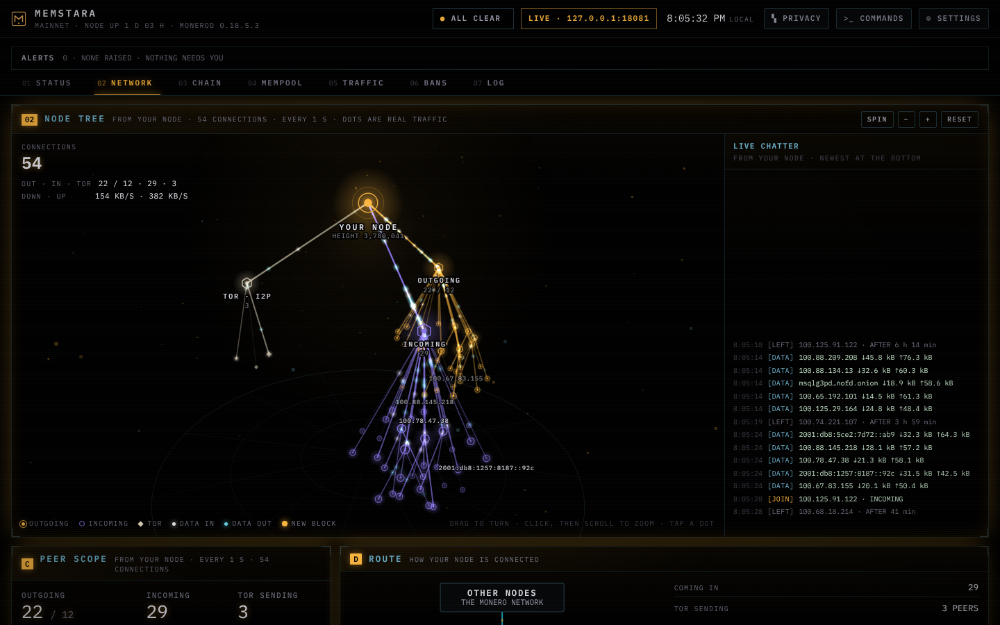

# Memstara

A dashboard for a Monero node, as a desktop app in its own window. It runs on
the same computer as `monerod`, or on another one that reaches the node over
the network. It shows the node's health, its connections, the
chain, the mempool, traffic and history, with a lamp wall that lights up when
something needs a look, a settings menu for every limit and display choice,
and a command drawer with `monerod`'s read-only console commands.

It only reads. It never changes Monero's code, and it can't change anything
on the node: it asks the node's RPC port the same questions `monerod`'s own
read-only console commands ask (each one is a front end for an RPC request,
see `src/daemon/rpc_command_executor.cpp` in Monero's source), and every
method it can send is on one short list in `memstara/rpc.py`. Monero updates
don't need dashboard updates. Besides RPC it reads only `monerod`'s own log
file, read-only, for things RPC doesn't report.



(The screenshot shows made-up test data, not a real node's peers.)

## What's on the screen

Seven screens, one per tab across the top (or all on one page, in Settings →
LOOK). Each opens with an animated picture drawn from the node's real
readings, then the panels for that part of the node. The ground is pure black
(pixels off on an OLED screen), with a slow breathing glow; a screen with a
problem pulses in the problem colour and its tab shows ■ (▲ for a heads-up).

| Screen | The picture at the top | Panels |
|---|---|---|
| STATUS | A ring with one segment per thing being watched, lit when something needs a look, with the height, time since the last block and quick readouts in the middle. Click a segment to open the screen that explains it. | A · Lamp wall |
| NETWORK | A 3D tree of every connection you can turn and zoom: outgoing, incoming and Tor, with peers on one company's servers grouped. The moving dots are the data each peer really sent and received. A live chatter log beside it. | C · Peer scope, D · Route |
| CHAIN | The last blocks as boxes receding into the distance, sized by weight and spaced by the wait before each, with the next block's timer. | B · Chain, K · System, L · Black marble watch |
| MEMPOOL | One dot per waiting transaction, in bands by how long it has waited. | H · Mempool |
| TRAFFIC | A scope of download and upload over the last 15 minutes. | F · Traffic, G · History |
| BANS | A clock of the short bans, each ring draining as its time runs out. | E · Ban list |
| LOG | Lanes of what happened in the last hour, with the newest typed out underneath. | I · Log |

| Panel | Shows |
|---|---|
| A · Lamp wall | One lamp per thing being watched. Grey is fine, a lit ▲ is a heads-up, a lit ■ is a problem. A new lamp flashes until you click ACK. TEST lights them all for 2 seconds. |
| B · Chain | Height, how long since the last block (and how unusual that wait is), the last 60 blocks drawn as a timeline, average gap, blocks replaced, network hashrate. |
| C · Peer scope | Every connection as a dot. Peers from the same company's servers stack at the same angle, so a spy cluster shows up as a pile-up. Distance from the middle is how long it's been connected. |
| D · Route | How the node is connected: other nodes, your node, Tor sending and the dashboard (with how fast the node answers). |
| E · Ban list | What your node is banning now, and the ranges at the eclipse limits. Read-only: banning is left to `monerod`'s own console. |
| F · Traffic | Download and upload now, and the last 15 minutes. |
| G · History | Connections, mempool and traffic over 15 min, 1 h, 6 h or 24 h, kept for 24 h. |
| H · Mempool | Transactions waiting, how long they've waited, double spends. |
| I · Log | Things that changed, newest first, including what `monerod`'s own log reports (reorgs, bans, errors). |
| K · System | Monero version, uptime, network rules version, bans, fees, disk space. |
| L · Black marble watch | What a new transaction's 16-member ring works like if one sender made the recent surge of new outputs, drawn as 16 dots, and the last 30 days of new outputs against a usual day. |

The pictures only move while their screen is open and in view, and Settings →
LOOK → Motion (or your desktop's reduce-animation setting) stills
them; they still update with every reading.

**Privacy mode.** The PRIVACY switch at the top hides addresses, ports, names,
folders and transaction ids behind a glitch, and shows every clock in UTC, so the
screens can be shown to other people or put in a screenshot. The hiding happens in the
app's server, so the real values never reach the window. Turning it off asks you to
type SHOW.

**Black marble watch.** A black marble flood is one sender making a great many
outputs so that other people's wallets pick theirs as decoys: every decoy they
own is one they can rule out, so a 16-member ring hides the real coin among
fewer members. Nobody can see who owns an output, so the BLACK MARBLE lamp
estimates the worst case: it compares the outputs in each block of the last
year with a usual day (the middle of the last 180 days), works out how often a
wallet would pick its decoys from the extra ones (the same way Monero's own
wallet picks them), and says what a new ring works like if one sender made
them all. It lights as a heads-up when that stays under 11 of 16 for 30
minutes, and as a problem under 8 (Settings → Alert limits, and Wait before
alerting). Tested on the chain's real history, it lit through most of the
suspected flood of March to June 2024 (about 5 of 16 at its worst) and stayed
quiet through 2025 and 2026. It can't tell a flood from a busy spell of
ordinary use, so a lit lamp means "wait if privacy matters", not "you are
being watched". It reads about 263,000 blocks once when it starts (showing how
far along it is), then only the newest. Details:
[docs/DESIGN.md](docs/DESIGN.md), "Black marble watch".

Every chart has a table view or a hover readout with the exact numbers.

## Run it

It needs Linux with a desktop (Wayland or X11), Python 3.10 or newer, and
two things for the window: PyGObject (GTK 4) and WebKitGTK 6.0, the web engine
GNOME's own apps draw with. The screens are drawn inside the app's own window:
there's no browser, address bar or tabs, and the window can't go anywhere but
its own screens.

Run it on the computer where `monerod` runs, or on another one that reaches
the node over the network (see
[A node on another computer](#a-node-on-another-computer-or-a-raspberry-pi)).

So far it has been tested on Ubuntu with GNOME. Other distributions and
desktops should work, but nobody has checked yet: reports are welcome.

**One time: get the window's packages.** In a terminal on that computer:

| System | Command |
|---|---|
| Debian, Ubuntu, Linux Mint | `sudo apt install -y git python3-gi gir1.2-webkit-6.0` |
| Fedora | `sudo dnf install -y git python3-gobject webkitgtk6.0` |
| Arch, Manjaro, EndeavourOS | `sudo pacman -S --needed git python-gobject webkitgtk-6.0` |

**One time: get the code and add it to your apps.**

```bash
git clone https://github.com/variablenine/Memstara ~/memstara
cd ~/memstara && python3 -m memstara --install
```

**Start it.** With the node running, open **Memstara** from your desktop's
app list (you can pin it to a dock or panel there). Or from a terminal:

```bash
cd ~/memstara && python3 -m memstara
```

Closing the window stops it. Stopping it never affects the node. Opening it
again while it runs just brings its window back.

| If the window | Do this |
|---|---|
| doesn't open, and the terminal says it needs PyGObject and WebKitGTK 6.0 | run the install command it prints (the one for your system above), then start it again |
| opens but stays blank or flickers | quit it (☰ → Quit), then start it with `python3 -m memstara --safe-graphics`, which draws without the graphics card's help |
| stays blank on Ubuntu 24.04, and the terminal says `bwrap: setting up uid map: Permission denied` | see [Ubuntu 24.04](#ubuntu-2404) below |
| says the app's window port is in use | another copy has port 18200: stop it with Ctrl+C in its terminal, or start with `--port 18201` |

On the first start it reads the node at `http://127.0.0.1:18081`, `monerod`'s
own default RPC address, and its log at `~/.bitmonero/bitmonero.log`. If yours
are somewhere else (`monerod`'s `--rpc-bind-port`, `--log-file` or
`--data-dir`), put them in Settings → Data source and Settings → Node's log,
then SAVE.

What to expect:

- The badge at the top says **LIVE** and your node's RPC address.
- Height and the outgoing and incoming counts match `monerod status`.

If something's off:

| What the screen says | What it means | What to do |
|---|---|---|
| THE NODE ISN'T ANSWERING | Nothing answered at the RPC address in Settings. | Check the node is running. It takes a minute or two to answer after a restart. If it listens somewhere else, put that address in Settings → Data source (TEST CONNECTION tries it). |
| THIS IS A RESTRICTED RPC PORT (badge shows LIMITED) | The address points at a restricted port, which hides some readings (see [A restricted RPC port](#a-restricted-rpc-port)). | To see everything, put the node's unrestricted port in Settings → Data source, then SAVE. |
| THE NODE ISN'T ANSWERING · THE NODE WANTS A LOGIN | `monerod` runs with `--rpc-login`. | Type the user and password in Settings → Data source. |

**Get updates later:**

```bash
cd ~/memstara && git pull
```

then ☰ (top right of the window) → **Quit**, and open the app again.

To start it automatically when you log in (in the background, so the history
keeps filling in), use ☰ → **Start when I log in** in the window, or see
[docs/START-AT-LOGIN.md](docs/START-AT-LOGIN.md). Started that way, closing
the window only hides it, and ☰ → **Quit** stops it.

`python3 -m memstara --uninstall` takes it out of your apps and out of start at
login again; your settings and history stay.

### Ubuntu 24.04

WebKitGTK always draws inside a sandbox (bubblewrap). Ubuntu 24.04 limits the
kind of sandbox it uses unless an AppArmor profile allows it, and that
profile ships with 24.04 but isn't switched on. Without it the window stays
blank. The fix reported for other apps hitting the same error is to switch on
that profile (untested with Memstara so far):

```bash
sudo apt install -y apparmor-profiles
sudo install -m 0644 /usr/share/apparmor/extra-profiles/bwrap-userns-restrict /etc/apparmor.d/
sudo apparmor_parser -r /etc/apparmor.d/bwrap-userns-restrict
```

Memstara never turns WebKitGTK's sandbox off, and you shouldn't either.

### A node on another computer (or a Raspberry Pi)

Memstara can read a node running somewhere else: a Raspberry Pi, a home
server, another PC. It talks to the node only through RPC, so everything RPC
answers works the same. `monerod`'s log is a file on that other computer, so
the log views stay empty unless you point Settings → Node's log at a copy or a
mounted folder. While the RPC address isn't on this computer, Memstara doesn't
read the log at the default place, since it may be another node's.

The node's unrestricted RPC port can change the node (ban peers, stop it), so
don't open it to your network. Reach it through an SSH tunnel instead, which
keeps it private and encrypted. On the computer running Memstara:

```bash
ssh -N -L 18081:127.0.0.1:18081 you@node-computer
```

Leave that running (or use `autossh` to keep it up), and set Settings → Data
source → Node RPC address to `http://127.0.0.1:18081`. Through a tunnel the
address is on this computer, so Memstara can't tell the node is elsewhere:
point Settings → Node's log at a copy of the node's log, or the log views show
whatever is at the default place here. If a node already runs on this
computer on 18081, pick another local port, for example
`-L 18091:127.0.0.1:18081` and `http://127.0.0.1:18091`.

If you do bind the node's RPC to your local network instead
(`--rpc-bind-ip <its LAN address> --confirm-external-bind`), also start it with
`--rpc-login name:password` and put the same in Settings → Data source. Plain
`http` on a network can still be read by anyone on it, and Memstara says so
once in the log.

A Raspberry Pi with a desktop can also run Memstara itself (Raspberry Pi OS is
Debian-based, so the Debian packages above apply), but that hasn't been
tested yet.

### A restricted RPC port

A restricted port (`monerod --restricted-rpc`, or the second port that
`--rpc-restricted-bind-port` adds) is a safety option: `monerod` itself
refuses any change on it, whoever asks. Memstara works with one and shows
LIMITED on the badge, but `monerod` doesn't answer every read there, so these
stay empty: the peers and their counts (the NETWORK screen, panels C and D),
traffic (the TRAFFIC screen), bans, sync details while it syncs, the node's
uptime and version, and the disk space left. The commands that read the same
things (`print_cn`, `print_pl`, `print_pool`, `bans`, `banned`, `sync_info`
and a few more) don't work there either. To see everything, use the
unrestricted port (through an SSH tunnel, as above, when the node is on
another computer).

## Commands

**COMMANDS** at the top opens `monerod`'s read-only console commands, grouped
and searchable: `status`, `print_cn`, `print_pl`, `sync_info`, `print_pool`,
`print_block`, `print_tx`, `bans`, `limit` and the rest, 26 in all. Each one
has a form for its arguments and draws the node's answer as tables (the raw
answer is one click away). It also shows the last lines of `monerod`'s log.

The console commands that change something (`ban`, `unban`, `out_peers`,
`flush_txpool`, `stop_daemon` and so on) aren't there, and neither are the
RPC methods they send. To ban a peer, use `monerod`'s own console. `print_bc`
takes at most 1,000 blocks at a time (the console has no limit).

## Reads beyond RPC

Some things about the node aren't in any RPC answer, so the dashboard also
reads `monerod`'s own log file, read-only (Settings → Node's log says where it
is): reorgs, blocks that lost a race, bans as they happen, errors and
warnings. That's all it reads besides RPC: nothing about the computer itself.
(Privacy mode looks up this computer's name, your user name, your real name
and your home folder, only to hide them. When the window's packages are
missing, it reads `/etc/os-release`, only to print the right install command.)

Not read: the chain database itself (RPC already serves what's in it, and its
layout changes between Monero versions), the ZMQ feed (with the node read every second,
it would only show new blocks a moment sooner) and `p2pstate.bin` (the same peer lists
`print_pl` shows).

## Safety

- Only its own window can use it. The window gets its readings from the
  app's own server on `127.0.0.1`, and that server answers only requests
  carrying a key that is new at every start and that only the window gets. A
  browser, or any other program or user on the computer, is turned away.
- It only reads. Every RPC method it can send is on one list in
  `memstara/rpc.py`, each a read, and anything else is refused before a
  request is made. A test fails if one of `monerod`'s methods that change
  something is ever added to that list (`tests/test_safety.py`).
- Requests that save its own settings or run a command also need a header
  only its own screens send, and requests from web pages are refused.
- The window makes no requests to the internet and can't go to any other
  address. Fonts are bundled. Camera, microphone, location, downloads, pop-up
  windows and WebGL are all off.
- It never writes to `monerod`'s files. Settings live in
  `~/.config/memstara/settings.json` (only your user can read it),
  history in `~/.local/state/memstara/`.
- Keyboard shortcuts are off by default, so stray key presses do nothing, and
  the window adds none of its own.

## For developers

- `docs/DESIGN.md`: the data contract between the server and the screens,
  the RPC calls and why, alert rules, `monerod`'s log, commands and
  settings.
- `docs/STYLE.md`: look and wording rules.
- `memstara/`: the server (Python standard library only) and the app window
  (`window.py`, GTK 4 and WebKitGTK through PyGObject; `desktop.py`, the app
  grid and start-at-login files). `web/`: the screens (plain HTML, CSS and
  JavaScript modules, no build step).
- Tests: `python3 -m unittest discover -s tests -v` (Python 3.10 or newer,
  nothing to install). They run against
  `tests/fake_monerod.py`, a test-only stand-in that answers with recorded
  `monerod` replies.

## Credits

The look takes cues from the sci-fi interface designs collected at
[uispace.org](https://uispace.org/) (SCENESCAPES by Annas Rahman), in
particular the mood of its "second party" scene. Everything here was drawn and
written from scratch: no code, images, wording or assets from that site are
used, and it has no license that would allow reuse. Fonts are IBM Plex Mono
and IBM Plex Sans Condensed under the SIL Open Font License 1.1 (see
`web/fonts/`).

## License

Memstara is free software: you can redistribute it and/or modify it under the
terms of the GNU General Public License as published by the Free Software
Foundation, either version 3 of the License, or (at your option) any later
version. It comes with no warranty. The full text is in [LICENSE](LICENSE).

Security problems: please report them privately, as [SECURITY.md](SECURITY.md)
says, not in a public issue.
